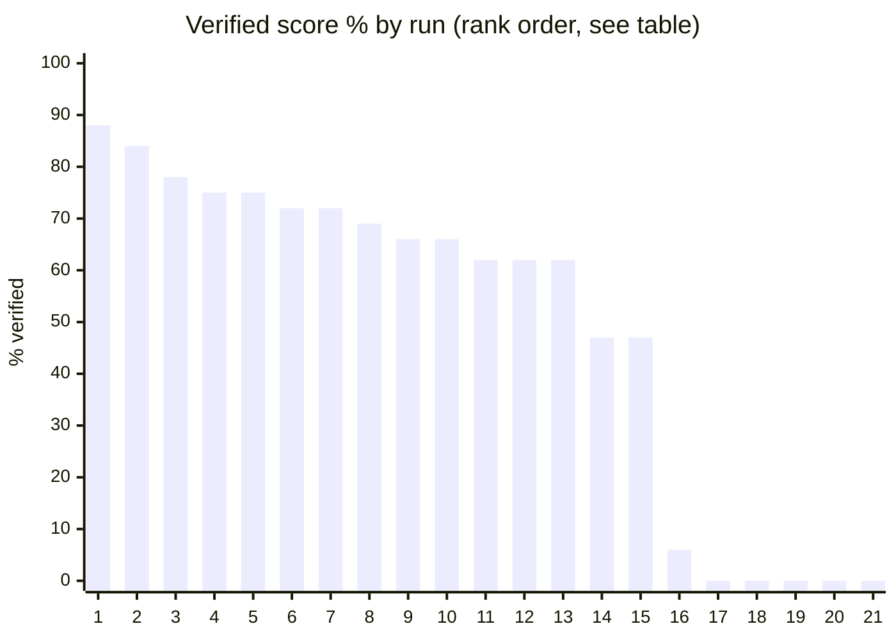
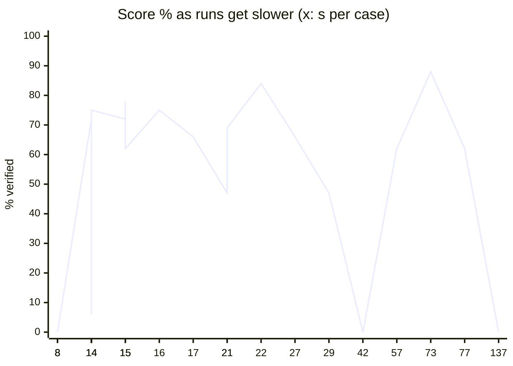

# TokenFrugal benchmark

Single report for every local-model test. Measured on an RTX 4060 Laptop 8 GB, 16384 ctx, temp 0.1, 16 real-world
cases x 2 runs (score out of 32). A case counts only when the output is verified, not when the model says it is done.

- Raw data: [`results/benchmark.csv`](results/benchmark.csv) (source of truth, one row per run)
- Interactive shortlist (filter by score, speed, size, case, hardware): [`explorer.html`](explorer.html)
- Re-run / add models: [`script/README.md`](script/README.md)

## Conclusions

| Need | Pick | Why |
|---|---|---|
| Highest quality, speed irrelevant | `ts-qwen3-8b-16384` | 28/32, but about 73 s per case |
| Best code default | `ts-gemma4-e4b-16384` | 27/32 at about 21 s per case |
| Fast and still at least 75% of best | `ts-qwen25c-7b-16384` | 23/32 at about 14 s per case |
| Builder role (tools, 64k ctx) | `qwen2.5-coder-yarn:3b` | 2/2 on data, docs, analyzer cases in 5-9 s |
| Thinker role | `llama3.2:3b-16k` | best thinker score per second, 2 GB |
| Drop | starcoder2-7b, qwen2.5-vl-7b, granite3.3-8b, gemma3-4b, deepseek-r1-8b, phi4-mini | 0-2/32, no usable tool calls |

Persona rule: smallest model that holds at least 75% of the best score for that persona's cases, then the fastest.

### Default model per persona

| Persona | Cases | Default | Ctx | Verified | s |
|---|---|---|---|---|---|
| engineering-backend-architect | write_function, fix_bug, write_tests, rename_across_files, find_symbol | `ts-gemma4-e4b-16384` | 16384 | 10/10 | 93 |
| testing-code-reviewer | review_sqli | `llama3.2:3b-16k` | 16384 | 2/2 | 12 |
| engineering-sre | debug_trace | `qwen2.5-coder-yarn:3b` | 65536 | 2/2 | 35 |
| support-docs-writer | summarize_readme, role_research | `ts-qwen3-8b-16384` | 16384 | 3/4 | 137 |
| engineering-software-architect | role_analyzer | `qwen2.5-coder-yarn:3b` | 65536 | 2/2 | 9 |
| gis-analyst | role_data | `qwen2.5-coder-yarn:3b` | 65536 | 2/2 | 5 |
| engineering-technical-writer | role_docs | `qwen2.5-coder-yarn:3b` | 65536 | 2/2 | 8 |
| security-auditor | role_security | `qwen2.5-coder-yarn:3b` | 65536 | 2/2 | 64 |
| design-ui-designer | role_designer | `llama3.2:3b-16k` | 16384 | 2/2 | 14 |
| testing-evidence-collector | role_browser | `llama3.2:3b-16k` | 16384 | 1/2 | 8 |
| project-management-project-shepherd | role_tracker | `llama3.2:3b-16k` | 16384 | 2/2 | 4 |

All defaults together: 30/32 in about 390 s (model swap time not included).

## Results

<!-- BEGIN:auto -->
_21 runs x 16 cases, generated from `results/benchmark.csv` by `script/build_report.py`. Interactive filtering: open `explorer.html`._

### Ranking (best score first, ties by speed)

| # | Run tag | Params | Score | % | s/case | Hardware |
|--:|---|---|--:|--:|--:|---|
| 1 | `full-ts-qwen3-8b-16384` | 8B | 28/32 | 88 | 72.7 | RTX 4060 8GB / 16384 ctx |
| 2 | `full-ts-gemma4-e4b-16384` | 4B eff. (8B raw) | 27/32 | 84 | 21.5 | RTX 4060 8GB / 16384 ctx |
| 3 | `confirmB` | 7B + 3B | 25/32 | 78 | 15.2 | RTX 4060 8GB / 16384 ctx |
| 4 | `confirmA` | 3B + 3B | 24/32 | 75 | 14.5 | RTX 4060 8GB / 16384 ctx |
| 5 | `full-ts-qwen25c-7b-builder-granite-thinker` | 7B + 3B | 24/32 | 75 | 16.0 | RTX 4060 8GB / 16384 ctx |
| 6 | `full-ts-qwen25c-7b-16384` | 7B | 23/32 | 72 | 13.9 | RTX 4060 8GB / 16384 ctx |
| 7 | `confirmC` | ? | 23/32 | 72 | 14.7 | RTX 4060 8GB / 16384 ctx |
| 8 | `full-defaults-yarn3b-llama32` | 3B + 3B | 22/32 | 69 | 21.4 | RTX 4060 8GB / 16384 ctx |
| 9 | `full-ts-qwen2-5-7b-16384` | 7B | 21/32 | 66 | 16.6 | RTX 4060 8GB / 16384 ctx |
| 10 | `full-ts-ministral-3-8b-16384` | 8B | 21/32 | 66 | 26.9 | RTX 4060 8GB / 16384 ctx |
| 11 | `full-llama3-2-3b-16k` | 3B | 20/32 | 62 | 15.2 | RTX 4060 8GB / 16384 ctx |
| 12 | `full-ts-michelrosselli-bonsai-27b-16384` | 27B | 20/32 | 62 | 57.3 | RTX 4060 8GB / 16384 ctx |
| 13 | `full-ts-qwen3-4b-16384` | 4B | 20/32 | 62 | 76.8 | RTX 4060 8GB / 16384 ctx |
| 14 | `full-yarn3b-solo` | ? | 15/32 | 47 | 20.7 | RTX 4060 8GB / 16384 ctx |
| 15 | `full-ts-llama3-1-8b-16384` | 8B | 15/32 | 47 | 28.7 | RTX 4060 8GB / 16384 ctx |
| 16 | `full-ts-phi4-mini-16384` | 3.8B | 2/32 | 6 | 14.0 | RTX 4060 8GB / 16384 ctx |
| 17 | `full-ts-qwen2-5vl-7b-16384` | 7B | 0/32 | 0 | 7.9 | RTX 4060 8GB / 16384 ctx |
| 18 | `full-ts-gemma3-4b-16384` | 4B | 0/32 | 0 | 7.9 | RTX 4060 8GB / 16384 ctx |
| 19 | `full-ts-starcoder2-7b-16384` | 7B | 0/32 | 0 | 8.0 | RTX 4060 8GB / 16384 ctx |
| 20 | `full-ts-granite3-3-8b-16384` | 8B | 0/32 | 0 | 41.9 | RTX 4060 8GB / 16384 ctx |
| 21 | `full-ts-deepseek-r1-8b-16384` | 8B | 0/32 | 0 | 137.1 | RTX 4060 8GB / 16384 ctx |

### Score by run



### Speed vs score



### Per-case heatmap (🟩 all verified, 🟨 partial, 🟥 none, · not run)

| Run | write function | fix bug | write tests | rename across files | find symbol | review sqli | debug trace | summarize readme | code graph search | list project files | read docs file | security file read | design overview | browser navigate snapshot | plan status | web crawl |
|---|---|---|---|---|---|---|---|---|---|---|---|---|---|---|---|---|
| `full-ts-qwen3-8b-16384` | 🟩 | 🟩 | 🟩 | 🟩 | 🟩 | 🟩 | 🟩 | 🟨 | 🟩 | 🟩 | 🟩 | 🟥 | 🟩 | 🟨 | 🟩 | 🟩 |
| `full-ts-gemma4-e4b-16384` | 🟩 | 🟩 | 🟩 | 🟩 | 🟩 | 🟩 | 🟩 | 🟥 | 🟩 | 🟩 | 🟩 | 🟨 | 🟩 | 🟥 | 🟩 | 🟩 |
| `confirmB` | 🟩 | 🟥 | 🟨 | 🟥 | 🟩 | 🟩 | 🟩 | 🟩 | 🟩 | 🟩 | 🟩 | 🟩 | 🟩 | 🟥 | 🟩 | 🟩 |
| `confirmA` | 🟩 | 🟨 | 🟥 | 🟥 | 🟨 | 🟩 | 🟩 | 🟨 | 🟩 | 🟩 | 🟩 | 🟩 | 🟩 | 🟨 | 🟩 | 🟩 |
| `full-ts-qwen25c-7b-builder-granite-t` | 🟩 | 🟨 | 🟨 | 🟥 | 🟩 | 🟩 | 🟩 | 🟩 | 🟩 | 🟩 | 🟩 | 🟩 | 🟩 | 🟥 | 🟥 | 🟩 |
| `full-ts-qwen25c-7b-16384` | 🟩 | 🟨 | 🟩 | 🟥 | 🟩 | 🟩 | 🟩 | 🟥 | 🟩 | 🟩 | 🟩 | 🟩 | 🟩 | 🟥 | 🟩 | 🟥 |
| `confirmC` | 🟥 | 🟩 | 🟥 | 🟥 | 🟩 | 🟩 | 🟩 | 🟥 | 🟩 | 🟩 | 🟩 | 🟩 | 🟩 | 🟨 | 🟩 | 🟩 |
| `full-defaults-yarn3b-llama32` | 🟨 | 🟩 | 🟥 | 🟨 | 🟨 | 🟩 | 🟩 | 🟥 | 🟨 | 🟩 | 🟩 | 🟩 | 🟩 | 🟨 | 🟩 | 🟨 |
| `full-ts-qwen2-5-7b-16384` | 🟥 | 🟩 | 🟩 | 🟥 | 🟩 | 🟩 | 🟨 | 🟥 | 🟩 | 🟩 | 🟩 | 🟩 | 🟩 | 🟥 | 🟩 | 🟥 |
| `full-ts-ministral-3-8b-16384` | 🟥 | 🟥 | 🟨 | 🟥 | 🟩 | 🟩 | 🟩 | 🟥 | 🟩 | 🟩 | 🟩 | 🟩 | 🟩 | 🟥 | 🟩 | 🟩 |
| `full-llama3-2-3b-16k` | 🟥 | 🟥 | 🟥 | 🟥 | 🟩 | 🟩 | 🟩 | 🟥 | 🟩 | 🟨 | 🟩 | 🟩 | 🟩 | 🟨 | 🟩 | 🟩 |
| `full-ts-michelrosselli-bonsai-27b-16` | 🟩 | 🟩 | 🟥 | 🟩 | 🟩 | 🟩 | 🟩 | 🟥 | 🟩 | 🟩 | 🟨 | 🟥 | 🟩 | 🟥 | 🟥 | 🟨 |
| `full-ts-qwen3-4b-16384` | 🟨 | 🟩 | 🟩 | 🟥 | 🟩 | 🟩 | 🟩 | 🟥 | 🟩 | 🟩 | 🟩 | 🟥 | 🟩 | 🟥 | 🟨 | 🟥 |
| `full-yarn3b-solo` | 🟨 | 🟨 | 🟥 | 🟥 | 🟨 | 🟨 | 🟩 | 🟥 | 🟩 | 🟩 | 🟩 | 🟩 | 🟥 | 🟥 | 🟨 | 🟥 |
| `full-ts-llama3-1-8b-16384` | 🟥 | 🟥 | 🟩 | 🟥 | 🟩 | 🟩 | 🟩 | 🟥 | 🟨 | 🟩 | 🟩 | 🟥 | 🟩 | 🟥 | 🟥 | 🟥 |
| `full-ts-phi4-mini-16384` | 🟥 | 🟥 | 🟥 | 🟥 | 🟥 | 🟥 | 🟥 | 🟥 | 🟥 | 🟥 | 🟥 | 🟥 | 🟩 | 🟥 | 🟥 | 🟥 |
| `full-ts-qwen2-5vl-7b-16384` | 🟥 | 🟥 | 🟥 | 🟥 | 🟥 | 🟥 | 🟥 | 🟥 | 🟥 | 🟥 | 🟥 | 🟥 | 🟥 | 🟥 | 🟥 | 🟥 |
| `full-ts-gemma3-4b-16384` | 🟥 | 🟥 | 🟥 | 🟥 | 🟥 | 🟥 | 🟥 | 🟥 | 🟥 | 🟥 | 🟥 | 🟥 | 🟥 | 🟥 | 🟥 | 🟥 |
| `full-ts-starcoder2-7b-16384` | 🟥 | 🟥 | 🟥 | 🟥 | 🟥 | 🟥 | 🟥 | 🟥 | 🟥 | 🟥 | 🟥 | 🟥 | 🟥 | 🟥 | 🟥 | 🟥 |
| `full-ts-granite3-3-8b-16384` | 🟥 | 🟥 | 🟥 | 🟥 | 🟥 | 🟥 | 🟥 | 🟥 | 🟥 | 🟥 | 🟥 | 🟥 | 🟥 | 🟥 | 🟥 | 🟥 |
| `full-ts-deepseek-r1-8b-16384` | 🟥 | 🟥 | 🟥 | 🟥 | 🟥 | 🟥 | 🟥 | 🟥 | 🟥 | 🟥 | 🟥 | 🟥 | 🟥 | 🟥 | 🟥 | 🟥 |
<!-- END:auto -->

## Observations

_Maintained by a cloud reviewer from the CSV; see the prompt in `script/README.md`. Last review: 2026-10-15 (initial import of 21 legacy runs)._

- The top two runs differ 5x in speed for one verified case; unless quality is critical, gemma4-e4b or qwen2.5-coder-7b is the better trade.
- Bigger is not better: bonsai-27b (20/32, 57 s) and qwen3-4b (20/32, 70+ s) match a 3B model at several times the cost.
- Six models score 0-2/32 because they lack tool calling; do not spend more benchmark time on them.
- Hardware: all rows are one machine; add rows from other GPUs before generalising.

## Haiku baseline and testing your own model

**Baseline.** Row `haiku-baseline` is Claude Haiku (`claude-haiku-5-5`) as the worker through the Anthropic OpenAI-compatible endpoint. It counts as a baseline only when the script finishes with no error, no manual adjustment and no extra step. It is a cloud reference, not a local one: the hardware column reads `cloud:api.anthropic.com`, and the context window is about 200k tokens against 16k for the local models. Compare scores and the `ctx_peak_tokens` column (largest single prompt, i.e. the window a model needs), not seconds.

**Columns added after the 16 case columns.** `date`, `endpoint`, `temperature` (`omitted` when the model rejects it), `max_tokens`, `builder_model`, `thinker_model`, `git_sha`, `n`, `ctx_peak_tokens`, `tokens_in_per_run`, `tokens_out_per_run`, and one `ctx_<case>` peak per case. Older rows leave them blank, so rows stay comparable over time.

**Forced tool calls.** The loop sends `tool_choice="required"` on the first step. Ollama accepts the field but does not enforce it (a live check returned plain text instead of a tool call), so small local models can still skip tools; the loop's retry handles that. Endpoints that reject the field get it removed and retried.

**Test your own model on your hardware.**

1. `python scripts/doctor.py` and fix anything it reports; `python scripts/install_profiles.py`; start backends with `scripts/mcp_up.ps1` (or `.sh`).
2. Pull the model: `ollama pull <model>`. Keep Ollama running with a 16384 context.
3. Run (the script runs its own preflight and stops with a fix command if a backend is down):

```bash
python Benchmark/script/run_benchmark.py <builder-model> [thinker-model] --tag <name>
```

4. For a cloud endpoint add `--endpoint <base-url> --api-key-env <ENV_VAR_NAME>`; export the key in your own shell first, it is never printed or stored.
5. `python Benchmark/script/build_report.py` rebuilds the tables from the CSV.
6. Optionally have a cloud model review the CSV and update Observations (prompt in `Benchmark/script/README.md`).
