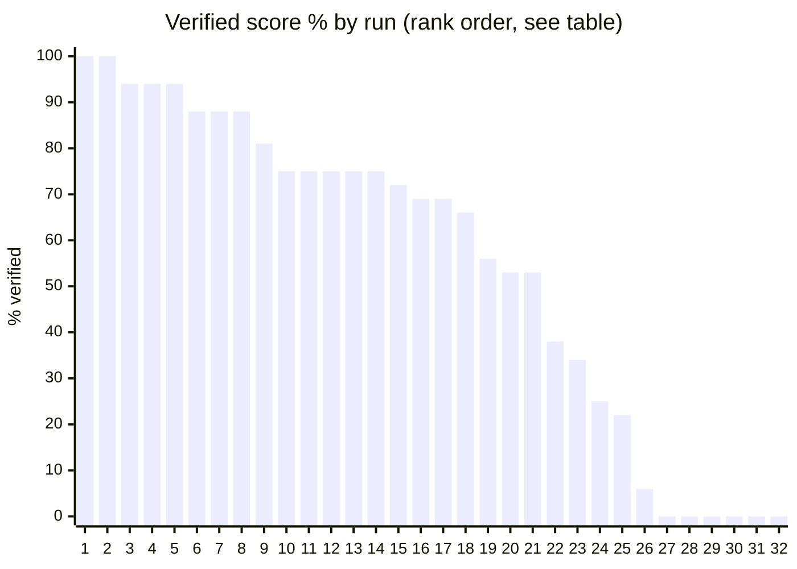
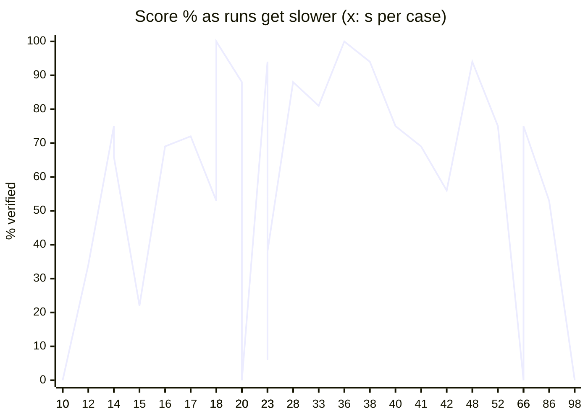

# TokenFrugal benchmark

Single report for every local-model test.

**Test hardware:** all local-model tests ran on an NVIDIA GeForce RTX 4060 Laptop GPU with 8 GB video memory (the Haiku baseline ran in the cloud). Settings: 16384 ctx, temp 0.1, 16 real-world
cases x 2 runs (score out of 32). A case counts only when the output is verified, not when the model says it is done.

- Raw data: [`results/benchmark.csv`](results/benchmark.csv) (source of truth, one row per run)
- Interactive shortlist (filter by score, speed, size, case, hardware): [`explorer.html`](explorer.html)
- Re-run / add models: [`script/README.md`](script/README.md)

## Conclusions

Measured on one laptop (RTX 4060, 8 GB), 16 cases. Re-run rows (`rerun*`) are single passes (max 16); older `batch-*` rows are two passes (max 32). Compare percentages, not raw scores. Two passes of the same model differ by up to 3 cases (Qwable 15 then 12, Mistral-Nemo 13 then 11), so gaps of 1-2 cases are noise.

- **Best local result:** `Qwen3.5-9B` IQ4_XS scored 16/16 and 15/16 (about 37 s/case). `Qwen3.5-4B` Q6_K scored 30/32 at 23 s/case, so it is the faster choice with a similar score.
- **Builder vs thinker:** the Builder and Thinker columns split each score. Mistral-Nemo is a strong thinker (12/12) but a weak builder (1/4), so it suits the thinker role only. The 9B Qwen models are strong in both roles.
- **Not usable:** `glm4:9b` and `gemma-3-12b` scored 0/16 because they answered without calling any tool; `gemma-3-4b`, `starcoder2` and `granite3.3-8b` also scored 0.
- **Too slow for the gain:** `Qwen2.5-Coder-32B` reaches 12/16 at 66 s/case because it spills out of 8 GB VRAM.
- **Defaults today:** `router/agents.yaml` sets `persona_models: {}`, so every persona uses its role's model (`qwen2.5-coder-yarn:3b` builder, `llama3.2:3b-16k` thinker). These two score 17/32 and 24/32 as single models in the table. No benchmarked model has replaced them yet; that choice is yours.

## Results

<!-- BEGIN:auto -->
_32 runs x 16 cases, generated from `results/benchmark.csv` by `script/build_report.py`. Interactive filtering: open `explorer.html`._

### Ranking (best score first, ties by speed)

| # | Model (builder = thinker) | Origin | Pull command | Params | Score | Builder | Thinker | % | s/case | total | valid |
|--:|---|---|---|---|--:|--:|--:|--:|--:|--:|--:|
| 1 | `claude-haiku-5-5` | Anthropic API | `not pullable (cloud baseline)` |  | 32/32 | 8/8 | 24/24 | 100 | 18.4 |  |  |
| 2 | `hf.co/unsloth/Qwen3.5-9B-GGUF:IQ4_XS` | Hugging Face: unsloth/Qwen3.5-9B-GGUF | `ollama pull hf.co/unsloth/Qwen3.5-9B-GGUF:IQ4_XS` | 9B | 16/16 | 4/4 | 12/12 | 100 | 36.3 | 9:40 | 16 |
| 3 | `hf.co/unsloth/Qwen3.5-4B-GGUF:Q6_K` | Hugging Face: unsloth/Qwen3.5-4B-GGUF | `ollama pull hf.co/unsloth/Qwen3.5-4B-GGUF:Q6_K` | 4B | 30/32 | 8/8 | 22/24 | 94 | 22.8 |  |  |
| 4 | `hf.co/unsloth/Qwen3.5-9B-GGUF:IQ4_XS` | Hugging Face: unsloth/Qwen3.5-9B-GGUF | `ollama pull hf.co/unsloth/Qwen3.5-9B-GGUF:IQ4_XS` | 9B | 15/16 | 4/4 | 11/12 | 94 | 38.4 | 10:14 | 16 |
| 5 | `hf.co/empero-ai/Qwable-9B-Claude-Fable-5-GGUF:Q4_K_M` | Hugging Face: empero-ai/Qwable-9B-Claude-Fable-5-GGUF | `ollama pull hf.co/empero-ai/Qwable-9B-Claude-Fable-5-GGUF:Q4_K_M` | 9B | 15/16 | 4/4 | 11/12 | 94 | 48.4 | 12:54 | 16 |
| 6 | `gemma4:e4b` | Ollama library | `ollama pull gemma4:e4b` | 4B | 28/32 | 8/8 | 20/24 | 88 | 19.5 |  |  |
| 7 | `hf.co/empero-ai/Qwen3.8-9B-Distill-GGUF:Q4_K_M` | Hugging Face: empero-ai/Qwen3.8-9B-Distill-GGUF | `ollama pull hf.co/empero-ai/Qwen3.8-9B-Distill-GGUF:Q4_K_M` | 9B | 14/16 | 3/4 | 11/12 | 88 | 27.5 | 7:19 | 16 |
| 8 | `hf.co/empero-ai/Qwen3.8-9B-Distill-GGUF:Q4_K_M` | Hugging Face: empero-ai/Qwen3.8-9B-Distill-GGUF | `ollama pull hf.co/empero-ai/Qwen3.8-9B-Distill-GGUF:Q4_K_M` | 9B | 14/16 | 3/4 | 11/12 | 88 | 28.2 | 7:32 | 16 |
| 9 | `hf.co/bartowski/Mistral-Nemo-Instruct-2407-GGUF:Q4_K_M` | Hugging Face: bartowski/Mistral-Nemo-Instruct-2407-GGUF | `ollama pull hf.co/bartowski/Mistral-Nemo-Instruct-2407-GGUF:Q4_K_M` |  | 13/16 | 1/4 | 12/12 | 81 | 33.0 | 8:48 | 16 |
| 10 | `llama3.2:3b-16k` | Ollama library + local Modelfile | `ollama pull llama3.2:3b && ollama create llama3.2:3b-16k -f models/thinker.Modelfile` | 3B | 24/32 | 2/8 | 22/24 | 75 | 14.2 |  |  |
| 11 | `qwen2.5-coder:7b` | Ollama library | `ollama pull qwen2.5-coder:7b` | 7B | 24/32 | 6/8 | 18/24 | 75 | 18.2 |  |  |
| 12 | `ministral-3:8b` | Ollama library | `ollama pull ministral-3:8b` | 8B | 24/32 | 4/8 | 20/24 | 75 | 40.0 |  |  |
| 13 | `hf.co/empero-ai/Qwable-9B-Claude-Fable-5-GGUF:Q4_K_M` | Hugging Face: empero-ai/Qwable-9B-Claude-Fable-5-GGUF | `ollama pull hf.co/empero-ai/Qwable-9B-Claude-Fable-5-GGUF:Q4_K_M` | 9B | 12/16 | 3/4 | 9/12 | 75 | 51.6 | 13:46 | 16 |
| 14 | `hf.co/bartowski/Qwen2.5-Coder-32B-Instruct-GGUF:IQ4_XS` | Hugging Face: bartowski/Qwen2.5-Coder-32B-Instruct-GGUF | `ollama pull hf.co/bartowski/Qwen2.5-Coder-32B-Instruct-GGUF:IQ4_XS` | 32B | 12/16 | 3/4 | 9/12 | 75 | 66.2 | 17:39 | 16 |
| 15 | `qwen2.5-coder:7b-instruct-q5_K_M` | Ollama library | `ollama pull qwen2.5-coder:7b-instruct-q5_K_M` | 7B | 23/32 | 5/8 | 18/24 | 72 | 17.3 |  |  |
| 16 | `qwen2.5:7b` | Ollama library | `ollama pull qwen2.5:7b` | 7B | 22/32 | 4/8 | 18/24 | 69 | 16.4 |  |  |
| 17 | `hf.co/bartowski/Mistral-Nemo-Instruct-2407-GGUF:Q4_K_M` | Hugging Face: bartowski/Mistral-Nemo-Instruct-2407-GGUF | `ollama pull hf.co/bartowski/Mistral-Nemo-Instruct-2407-GGUF:Q4_K_M` |  | 11/16 | 1/4 | 10/12 | 69 | 40.8 | 10:53 | 16 |
| 18 | `granite4:micro` | Ollama library | `ollama pull granite4:micro` |  | 21/32 | 3/8 | 18/24 | 66 | 14.4 |  |  |
| 19 | `llama3.1:8b` | Ollama library | `ollama pull llama3.1:8b` | 8B | 18/32 | 2/8 | 16/24 | 56 | 41.8 |  |  |
| 20 | `qwen2.5-coder-yarn:3b` | Ollama library + local Modelfile | `ollama pull qwen2.5-coder:3b && ollama create qwen2.5-coder-yarn:3b -f models/builder.Modelfile` | 3B | 17/32 | 4/8 | 13/24 | 53 | 18.0 |  |  |
| 21 | `hf.co/empero-ai/Qwythos-9B-v2-GGUF:Q4_K_M` | Hugging Face: empero-ai/Qwythos-9B-v2-GGUF | `ollama pull hf.co/empero-ai/Qwythos-9B-v2-GGUF:Q4_K_M` | 9B | 17/32 | 5/8 | 12/24 | 53 | 86.4 |  |  |
| 22 | `hf.co/bartowski/Mistral-Nemo-Instruct-2407-GGUF:Q4_K_M` | Hugging Face: bartowski/Mistral-Nemo-Instruct-2407-GGUF | `ollama pull hf.co/bartowski/Mistral-Nemo-Instruct-2407-GGUF:Q4_K_M` |  | 12/32 | 0/8 | 12/24 | 38 | 23.3 |  |  |
| 23 | `qwen2.5:1.5b` | Ollama library | `ollama pull qwen2.5:1.5b` | 1.5B | 11/32 | 0/8 | 11/24 | 34 | 12.0 |  |  |
| 24 | `llama3.2:1b` | Ollama library | `ollama pull llama3.2:1b` | 1B | 8/32 | 0/8 | 8/24 | 25 | 20.2 |  |  |
| 25 | `granite3.3:2b` | Ollama library | `ollama pull granite3.3:2b` | 2B | 7/32 | 0/8 | 7/24 | 22 | 15.2 |  |  |
| 26 | `phi4-mini:latest` | Ollama library | `ollama pull phi4-mini:latest` |  | 2/32 | 0/8 | 2/24 | 6 | 23.2 |  |  |
| 27 | `gemma3:4b` | Ollama library | `ollama pull gemma3:4b` | 4B | 0/32 | 0/8 | 0/24 | 0 | 9.5 |  |  |
| 28 | `starcoder2:7b` | Ollama library | `ollama pull starcoder2:7b` | 7B | 0/32 | 0/8 | 0/24 | 0 | 9.6 |  |  |
| 29 | `hf.co/bartowski/google_gemma-3-12b-it-GGUF:Q4_K_M` | Hugging Face: bartowski/google_gemma-3-12b-it-GGUF | `ollama pull hf.co/bartowski/google_gemma-3-12b-it-GGUF:Q4_K_M` | 12B | 0/16 | 0/4 | 0/12 | 0 | 10.4 | 2:47 | 16 |
| 30 | `glm4:9b-chat-q5_K_M` | Ollama library | `ollama pull glm4:9b-chat-q5_K_M` | 9B | 0/16 | 0/4 | 0/12 | 0 | 20.5 | 5:28 | 16 |
| 31 | `hf.co/lmstudio-community/DeepSeek-R1-Distill-Qwen-7B-GGUF:latest` | Hugging Face: lmstudio-community/DeepSeek-R1-Distill-Qwen-7B-GGUF | `ollama pull hf.co/lmstudio-community/DeepSeek-R1-Distill-Qwen-7B-GGUF:latest` |  | 0/32 | 0/8 | 0/24 | 0 | 65.7 |  |  |
| 32 | `granite3.3:8b` | Ollama library | `ollama pull granite3.3:8b` | 8B | 0/32 | 0/8 | 0/24 | 0 | 97.9 |  |  |

### Best model per role (local models, top 5 each)

Each role is ranked only on its own cases, because one model is pinned to both roles in a run. Only a model's newest-dated runs count, so older results from earlier code never mix with current ones; the `Code (git)` column shows the commit that produced them. Results change as the router and harness change, so re-run a model after significant changes before trusting its place. Ties go to the model with more evidence, then the faster one. `Shared memory GB` above 0 means part of the model spilled off the GPU, which is slower. The Haiku cloud baseline is left out because it cannot be pulled.

**Builder** (cases: `write_function`, `fix_bug`, `write_tests`, `rename_across_files`)

| # | Model | Date | Code (git) | Role score | % | Runs | s/case | Shared memory GB | Pull command |
|--:|---|---|---|--:|--:|--:|--:|--:|---|
| 1 | `gemma4:e4b` | 2026-10-16 | `ab3e34f` | 8/8 | 100 | 1 | 19.5 | 0.0 | `ollama pull gemma4:e4b` |
| 2 | `hf.co/unsloth/Qwen3.5-4B-GGUF:Q6_K` | 2026-10-16 | `ab3e34f` | 8/8 | 100 | 1 | 22.8 | 0.0 | `ollama pull hf.co/unsloth/Qwen3.5-4B-GGUF:Q6_K` |
| 3 | `hf.co/unsloth/Qwen3.5-9B-GGUF:IQ4_XS` | 2026-10-16 | `6e6f19e` | 8/8 | 100 | 2 | 37.3 |  | `ollama pull hf.co/unsloth/Qwen3.5-9B-GGUF:IQ4_XS` |
| 4 | `hf.co/empero-ai/Qwable-9B-Claude-Fable-5-GGUF:Q4_K_M` | 2026-10-16 | `6e6f19e` | 7/8 | 88 | 2 | 50.0 |  | `ollama pull hf.co/empero-ai/Qwable-9B-Claude-Fable-5-GGUF:Q4_K_M` |
| 5 | `qwen2.5-coder:7b` | 2026-10-16 | `ab3e34f` | 6/8 | 75 | 1 | 18.2 | 0.0 | `ollama pull qwen2.5-coder:7b` |

**Thinker** (cases: `find_symbol`, `review_sqli`, `debug_trace`, `summarize_readme`, `code_graph_search`, `list_project_files`, `read_docs_file`, `security_file_read`, `design_overview`, `browser_navigate_snapshot`, `plan_status`, `web_crawl`)

| # | Model | Date | Code (git) | Role score | % | Runs | s/case | Shared memory GB | Pull command |
|--:|---|---|---|--:|--:|--:|--:|--:|---|
| 1 | `hf.co/unsloth/Qwen3.5-9B-GGUF:IQ4_XS` | 2026-10-16 | `6e6f19e` | 23/24 | 96 | 2 | 37.3 |  | `ollama pull hf.co/unsloth/Qwen3.5-9B-GGUF:IQ4_XS` |
| 2 | `llama3.2:3b-16k` | 2026-10-15 | `ab3e34f` | 22/24 | 92 | 1 | 14.2 | 0.0 | `ollama pull llama3.2:3b && ollama create llama3.2:3b-16k -f models/thinker.Modelfile` |
| 3 | `hf.co/unsloth/Qwen3.5-4B-GGUF:Q6_K` | 2026-10-16 | `ab3e34f` | 22/24 | 92 | 1 | 22.8 | 0.0 | `ollama pull hf.co/unsloth/Qwen3.5-4B-GGUF:Q6_K` |
| 4 | `hf.co/empero-ai/Qwen3.8-9B-Distill-GGUF:Q4_K_M` | 2026-10-16 | `6e6f19e` | 22/24 | 92 | 2 | 27.9 |  | `ollama pull hf.co/empero-ai/Qwen3.8-9B-Distill-GGUF:Q4_K_M` |
| 5 | `gemma4:e4b` | 2026-10-16 | `ab3e34f` | 20/24 | 83 | 1 | 19.5 | 0.0 | `ollama pull gemma4:e4b` |

### Score by run



### Speed vs score



### How to read this

- Each **run** is one local model setup, scored on the same 16 cases. `score` is passes out of `max`.
- **Builder** (`qwen2.5-coder-yarn:3b`) writes code and edits files. **Thinker** (`llama3.2:3b-16k`) reads, analyses and browses.
- A task uses **one** model at a time. Models never run together or talk to each other.
- The role table shows which tools each role is allowed to call. A case needs the tools of its role.
- 🟩 all checks passed, 🟨 some passed, 🟥 none passed, `·` not run.
- ⚠ on a case that needs a specific tool means that run scored 0 on it, so the tool was likely missing or not called.

### Roles and models (from `router/agents.yaml`)

| Role | Model class | Tools the role may call |
|---|---|---|
| `builder` | builder (`qwen2.5-coder-yarn:3b`) | `read_file`, `write_file`, `edit_file`, `search_files`, `search_graph`, `get_code_snippet` |
| `data` | builder (`qwen2.5-coder-yarn:3b`) | `read_file`, `list_directory` |
| `analyzer` | thinker (`llama3.2:3b-16k`) | `read_file`, `search_graph`, `get_code_snippet`, `trace_path`, `git_diff`, `ast-grep` |
| `security` | thinker (`llama3.2:3b-16k`) | `read_file`, `search_files`, `ast-grep`, `search_sonar_issues_in_projects`, `search_security_hotspots`, `show_rule` |
| `reviewer` | thinker (`llama3.2:3b-16k`) | `read_file`, `git_diff`, `get_code_snippet`, `trace_path`, `ast-grep` |
| `debugger` | thinker (`llama3.2:3b-16k`) | `read_file`, `search_graph`, `trace_path`, `git_log`, `sequentialthinking`, `execute_code` |
| `docs` | thinker (`llama3.2:3b-16k`) | `read_file`, `list_directory`, `git_log`, `fetch` |
| `designer` | thinker (`llama3.2:3b-16k`) | `high_level_overview`, `penpot_api_info`, `execute_code`, `export_shape` |
| `browser` | thinker (`llama3.2:3b-16k`) | `navigate_page`, `take_snapshot`, `take_screenshot`, `list_console_messages`, `list_network_requests`, `lighthouse_audit` |
| `tracker` | thinker (`llama3.2:3b-16k`) | `plan_next`, `plan_claim`, `plan_status`, `plan_blockers`, `plan_done`, `plan_note` |
| `github-read` | thinker (`llama3.2:3b-16k`) | `list_pull_requests`, `pull_request_read`, `issue_read`, `list_issues`, `get_file_contents` |
| `github-actions-read` | thinker (`llama3.2:3b-16k`) | `actions_list`, `actions_get`, `get_job_logs` |
| `devops` | builder (`qwen2.5-coder-yarn:3b`) | `read_file`, `write_file`, `edit_file`, `git_diff`, `git_log`, `execute_code` |
| `finance` | thinker (`llama3.2:3b-16k`) | `read_file`, `list_directory`, `fetch`, `web_search`, `crawl_markdown` |
| `research` | thinker (`llama3.2:3b-16k`) | `web_search`, `crawl_markdown`, `crawl_links` |

### Builder cases (code and file edits: needs write/edit tools)

| Run | write function | fix bug | write tests | rename across files |
|---|---|---|---|---|
| `claude-haiku-5-5` | 🟩 | 🟩 | 🟩 | 🟩 |
| `hf.co/unsloth/Qwen3.5-9B-GGUF:IQ4_XS` | 🟩 | 🟩 | 🟩 | 🟩 |
| `hf.co/unsloth/Qwen3.5-4B-GGUF:Q6_K` | 🟩 | 🟩 | 🟩 | 🟩 |
| `hf.co/unsloth/Qwen3.5-9B-GGUF:IQ4_XS` | 🟩 | 🟩 | 🟩 | 🟩 |
| `hf.co/empero-ai/Qwable-9B-Claude-Fable-5-GGU` | 🟩 | 🟩 | 🟩 | 🟩 |
| `gemma4:e4b` | 🟩 | 🟩 | 🟩 | 🟩 |
| `hf.co/empero-ai/Qwen3.8-9B-Distill-GGUF:Q4_K` | 🟩 | 🟩 | 🟥 | 🟩 |
| `hf.co/empero-ai/Qwen3.8-9B-Distill-GGUF:Q4_K` | 🟩 | 🟩 | 🟥 | 🟩 |
| `hf.co/bartowski/Mistral-Nemo-Instruct-2407-G` | 🟥 | 🟩 | 🟥 | 🟥 |
| `llama3.2:3b-16k` | 🟥 | 🟥 | 🟥 | 🟩 |
| `qwen2.5-coder:7b` | 🟩 | 🟩 | 🟩 | 🟥 |
| `ministral-3:8b` | 🟩 | 🟩 | 🟥 | 🟥 |
| `hf.co/empero-ai/Qwable-9B-Claude-Fable-5-GGU` | 🟥 | 🟩 | 🟩 | 🟩 |
| `hf.co/bartowski/Qwen2.5-Coder-32B-Instruct-G` | 🟩 | 🟩 | 🟥 | 🟩 |
| `qwen2.5-coder:7b-instruct-q5_K_M` | 🟩 | 🟨 | 🟩 | 🟥 |
| `qwen2.5:7b` | 🟥 | 🟩 | 🟨 | 🟨 |
| `hf.co/bartowski/Mistral-Nemo-Instruct-2407-G` | 🟥 | 🟩 | 🟥 | 🟥 |
| `granite4:micro` | 🟨 | 🟨 | 🟥 | 🟨 |
| `llama3.1:8b` | 🟥 | 🟥 | 🟥 | 🟩 |
| `qwen2.5-coder-yarn:3b` | 🟨 | 🟩 | 🟥 | 🟨 |
| `hf.co/empero-ai/Qwythos-9B-v2-GGUF:Q4_K_M` | 🟨 | 🟩 | 🟥 | 🟩 |
| `hf.co/bartowski/Mistral-Nemo-Instruct-2407-G` | 🟥 | 🟥 | 🟥 | 🟥 |
| `qwen2.5:1.5b` | 🟥 | 🟥 | 🟥 | 🟥 |
| `llama3.2:1b` | 🟥 | 🟥 | 🟥 | 🟥 |
| `granite3.3:2b` | 🟥 | 🟥 | 🟥 | 🟥 |
| `phi4-mini:latest` | 🟥 | 🟥 | 🟥 | 🟥 |
| `gemma3:4b` | 🟥 | 🟥 | 🟥 | 🟥 |
| `starcoder2:7b` | 🟥 | 🟥 | 🟥 | 🟥 |
| `hf.co/bartowski/google_gemma-3-12b-it-GGUF:Q` | 🟥 | 🟥 | 🟥 | 🟥 |
| `glm4:9b-chat-q5_K_M` | 🟥 | 🟥 | 🟥 | 🟥 |
| `hf.co/lmstudio-community/DeepSeek-R1-Distill` | 🟥 | 🟥 | 🟥 | 🟥 |
| `granite3.3:8b` | 🟥 | 🟥 | 🟥 | 🟥 |

### Thinker cases (read, analyse, browse: needs read/graph/browser tools)

| Run | find symbol | review sqli | debug trace | summarize readme | code graph search | list project files | read docs file | security file read | design overview | browser navigate snapshot | plan status | web crawl |
|---|---|---|---|---|---|---|---|---|---|---|---|---|
| `claude-haiku-5-5` | 🟩 | 🟩 | 🟩 | 🟩 | 🟩 | 🟩 | 🟩 | 🟩 | 🟩 | 🟩 | 🟩 | 🟩 |
| `hf.co/unsloth/Qwen3.5-9B-GGUF:IQ4_XS` | 🟩 | 🟩 | 🟩 | 🟩 | 🟩 | 🟩 | 🟩 | 🟩 | 🟩 | 🟩 | 🟩 | 🟩 |
| `hf.co/unsloth/Qwen3.5-4B-GGUF:Q6_K` | 🟩 | 🟩 | 🟩 | 🟨 | 🟩 | 🟩 | 🟩 | 🟩 | 🟩 | 🟨 | 🟩 | 🟩 |
| `hf.co/unsloth/Qwen3.5-9B-GGUF:IQ4_XS` | 🟩 | 🟩 | 🟩 | 🟩 | 🟩 | 🟩 | 🟩 | 🟥 | 🟩 | 🟩 | 🟩 | 🟩 |
| `hf.co/empero-ai/Qwable-9B-Claude-Fable-5-GGU` | 🟩 | 🟩 | 🟩 | 🟩 | 🟩 | 🟩 | 🟩 | 🟩 | 🟩 | 🟥⚠ | 🟩 | 🟩 |
| `gemma4:e4b` | 🟩 | 🟩 | 🟩 | 🟥 | 🟩 | 🟩 | 🟩 | 🟩 | 🟩 | 🟨 | 🟨 | 🟩 |
| `hf.co/empero-ai/Qwen3.8-9B-Distill-GGUF:Q4_K` | 🟩 | 🟩 | 🟩 | 🟩 | 🟩 | 🟩 | 🟩 | 🟥 | 🟩 | 🟩 | 🟩 | 🟩 |
| `hf.co/empero-ai/Qwen3.8-9B-Distill-GGUF:Q4_K` | 🟩 | 🟩 | 🟩 | 🟩 | 🟩 | 🟩 | 🟩 | 🟥 | 🟩 | 🟩 | 🟩 | 🟩 |
| `hf.co/bartowski/Mistral-Nemo-Instruct-2407-G` | 🟩 | 🟩 | 🟩 | 🟩 | 🟩 | 🟩 | 🟩 | 🟩 | 🟩 | 🟩 | 🟩 | 🟩 |
| `llama3.2:3b-16k` | 🟩 | 🟩 | 🟩 | 🟥 | 🟩 | 🟩 | 🟩 | 🟩 | 🟩 | 🟩 | 🟩 | 🟩 |
| `qwen2.5-coder:7b` | 🟩 | 🟩 | 🟩 | 🟥 | 🟩 | 🟩 | 🟩 | 🟩 | 🟩 | 🟥⚠ | 🟩 | 🟥 |
| `ministral-3:8b` | 🟩 | 🟩 | 🟩 | 🟥 | 🟩 | 🟩 | 🟩 | 🟩 | 🟩 | 🟥⚠ | 🟩 | 🟩 |
| `hf.co/empero-ai/Qwable-9B-Claude-Fable-5-GGU` | 🟩 | 🟩 | 🟩 | 🟩 | 🟩 | 🟩 | 🟩 | 🟥 | 🟩 | 🟥⚠ | 🟥⚠ | 🟩 |
| `hf.co/bartowski/Qwen2.5-Coder-32B-Instruct-G` | 🟩 | 🟩 | 🟩 | 🟩 | 🟩 | 🟩 | 🟩 | 🟥 | 🟩 | 🟥⚠ | 🟥⚠ | 🟩 |
| `qwen2.5-coder:7b-instruct-q5_K_M` | 🟩 | 🟩 | 🟩 | 🟥 | 🟩 | 🟩 | 🟩 | 🟩 | 🟩 | 🟥⚠ | 🟩 | 🟥 |
| `qwen2.5:7b` | 🟩 | 🟩 | 🟨 | 🟥 | 🟩 | 🟩 | 🟩 | 🟩 | 🟩 | 🟨 | 🟩 | 🟥 |
| `hf.co/bartowski/Mistral-Nemo-Instruct-2407-G` | 🟩 | 🟩 | 🟩 | 🟩 | 🟩 | 🟩 | 🟩 | 🟥 | 🟩 | 🟩 | 🟥⚠ | 🟩 |
| `granite4:micro` | 🟩 | 🟩 | 🟩 | 🟥 | 🟩 | 🟩 | 🟩 | 🟥 | 🟩 | 🟥⚠ | 🟩 | 🟩 |
| `llama3.1:8b` | 🟩 | 🟩 | 🟩 | 🟥 | 🟩 | 🟩 | 🟩 | 🟥 | 🟩 | 🟥⚠ | 🟩 | 🟥 |
| `qwen2.5-coder-yarn:3b` | 🟥 | 🟥 | 🟩 | 🟥 | 🟩 | 🟩 | 🟩 | 🟥 | 🟩 | 🟥⚠ | 🟩 | 🟨 |
| `hf.co/empero-ai/Qwythos-9B-v2-GGUF:Q4_K_M` | 🟩 | 🟩 | 🟩 | 🟥 | 🟩 | 🟩 | 🟩 | 🟥 | 🟥⚠ | 🟥⚠ | 🟥⚠ | 🟥 |
| `hf.co/bartowski/Mistral-Nemo-Instruct-2407-G` | 🟥 | 🟥 | 🟥 | 🟥 | 🟥 | 🟩 | 🟩 | 🟩 | 🟩 | 🟨 | 🟨 | 🟩 |
| `qwen2.5:1.5b` | 🟩 | 🟥 | 🟩 | 🟥 | 🟩 | 🟩 | 🟥 | 🟥 | 🟨 | 🟥⚠ | 🟩 | 🟥 |
| `llama3.2:1b` | 🟥 | 🟥 | 🟥 | 🟥 | 🟥 | 🟩 | 🟩 | 🟥 | 🟩 | 🟥⚠ | 🟩 | 🟥 |
| `granite3.3:2b` | 🟥 | 🟥 | 🟥 | 🟥 | 🟥 | 🟩 | 🟥 | 🟥 | 🟨 | 🟩 | 🟩 | 🟥 |
| `phi4-mini:latest` | 🟥 | 🟥 | 🟥 | 🟥 | 🟥 | 🟥 | 🟥 | 🟥 | 🟩 | 🟥⚠ | 🟥⚠ | 🟥 |
| `gemma3:4b` | 🟥 | 🟥 | 🟥 | 🟥 | 🟥 | 🟥 | 🟥 | 🟥 | 🟥⚠ | 🟥⚠ | 🟥⚠ | 🟥 |
| `starcoder2:7b` | 🟥 | 🟥 | 🟥 | 🟥 | 🟥 | 🟥 | 🟥 | 🟥 | 🟥⚠ | 🟥⚠ | 🟥⚠ | 🟥 |
| `hf.co/bartowski/google_gemma-3-12b-it-GGUF:Q` | 🟥 | 🟥 | 🟥 | 🟥 | 🟥 | 🟥 | 🟥 | 🟥 | 🟥⚠ | 🟥⚠ | 🟥⚠ | 🟥 |
| `glm4:9b-chat-q5_K_M` | 🟥 | 🟥 | 🟥 | 🟥 | 🟥 | 🟥 | 🟥 | 🟥 | 🟥⚠ | 🟥⚠ | 🟥⚠ | 🟥 |
| `hf.co/lmstudio-community/DeepSeek-R1-Distill` | 🟥 | 🟥 | 🟥 | 🟥 | 🟥 | 🟥 | 🟥 | 🟥 | 🟥⚠ | 🟥⚠ | 🟥⚠ | 🟥 |
| `granite3.3:8b` | 🟥 | 🟥 | 🟥 | 🟥 | 🟥 | 🟥 | 🟥 | 🟥 | 🟥⚠ | 🟥⚠ | 🟥⚠ | 🟥 |
<!-- END:auto -->

## Observations

Only facts that can be read from `results/benchmark.csv` are stated here.

- The CSV holds 21 runs. Each run is scored out of 32 (16 cases x 2 runs).
- Each case cell shows `passed/checks`. The heatmap colours are read from those cells. A `⚠` marks a case that needs a specific tool and scored 0 in that run.
- Speed (`mean_s_per_case`, `total_s`) and the context columns are recorded per run. They are not compared across hardware here.
- These observations will be replaced after the final re-run.

## Haiku baseline and testing your own model

**Baseline.** Row `haiku-baseline` is Claude Haiku (`claude-haiku-5-5`) as the worker through the Anthropic OpenAI-compatible endpoint. It counts as a baseline only when the script finishes with no error, no manual adjustment and no extra step. It is a cloud reference, not a local one: the hardware column reads `cloud:api.anthropic.com`, and the context window is about 200k tokens against 16k for the local models. Compare scores and the `ctx_peak_tokens` column (largest single prompt, i.e. the window a model needs), not seconds.

**Columns added after the 16 case columns.** `date`, `endpoint`, `temperature` (`omitted` when the model rejects it), `max_tokens`, `builder_model`, `thinker_model`, `git_sha`, `n`, `ctx_peak_tokens`, `tokens_in_per_run`, `tokens_out_per_run`, and one `ctx_<case>` peak per case. Older rows leave them blank, so rows stay comparable over time.

**Forced tool calls.** The loop sends `tool_choice="required"` on the first step. Ollama accepts the field but does not enforce it (a live check returned plain text instead of a tool call), so small local models can still skip tools; the loop's retry handles that. Endpoints that reject the field get it removed and retried.

**Test your own model on your hardware.**

1. `python scripts/doctor.py` and fix anything it reports; `python scripts/install_profiles.py`; start backends with `scripts/mcp_up.ps1` (or `.sh`).
2. Pull the model: `ollama pull <model>`. Keep Ollama running with a 16384 context.
3. Run. The preflight checks Docker, the 8 MCP profiles, that every profile mounts the parent folder `<Projects>:/workspace` (cases address `/workspace/<project>/...`), Neo4j on 127.0.0.1:7697 and the model, and stops with a fix command on any FAIL:

```bash
python Benchmark/script/run_benchmark.py <builder-model> [thinker-model] --tag <name>
```

4. For a cloud endpoint add `--endpoint <base-url> --api-key-env <ENV_VAR_NAME>`; export the key in your own shell first, it is never printed or stored.
5. `python Benchmark/script/build_report.py` rebuilds the tables from the CSV.
6. Optionally have a cloud model review the CSV and update Observations (prompt in `Benchmark/script/README.md`).
