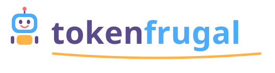

<p align="center"></p>

# TokenFrugal

**Hand routine coding work to a free local LLM, and keep your paid cloud model for planning and hard decisions.**

TokenFrugal is an MCP server. Your cloud agent (Claude Code, Codex, Cursor or any MCP client) calls one tool, `dispatch_task(agent, task)`. A local model does the work and returns a 150-300 token summary, so your cloud quota pays for thinking, not for boilerplate.

## Why TokenFrugal

- **Lower token spend.** Tests, docstrings, lint fixes, file edits and log reading go to a local model. The cloud agent only sees a short summary.
- **Private by default.** Local models run on your machine. Only summaries and a `task_id` return to the cloud agent.
- **No surprise bills.** A failed task returns a short error and a `task_id` you can resume. Nothing falls back silently to the cloud.
- **Small models that stay on track.** Each role gets a tool allowlist of 4-6 tools, and runs one model at a time.
- **Visible and auditable.** A live dashboard shows every tool call, and the task log is stored locally.

## Use cases

1. **Stretching a limited subscription.** Your seat has tight limits. Send unit tests, docstrings and boilerplate to `builder`, and keep the cloud model for design and review.
2. **Triaging logs and test output.** Ask the `analyzer` or `debugger` role to read a long log or failing test run and return the root cause in a few lines.
3. **Reviewing and scanning code before a merge.** The `reviewer` role checks a diff, and the `security` role runs SonarQube rules, all on local models.
4. **Working on confidential code.** For client or internal code that must not leave the machine, the source stays local and only summaries reach the cloud agent.
5. **Documentation, design and browser checks.** Route docs to `docs`, UI mock-ups to `designer`, and page audits to `browser`, each with its own persona and tools.

## Install (Windows, macOS, Linux)

You need Python 3.11+, git, Docker, and [Ollama](https://ollama.com) (or any OpenAI-compatible LLM API). Pick your agent below: each has the steps, then a prompt you can paste into the agent to do the install for you.

### Install the router

```bash
git clone https://github.com/maxh8086/tokenfrugal.git
cd tokenfrugal
python -m venv .venv
```

Activate the environment:

- **Windows (PowerShell):** `.venv\Scripts\Activate.ps1`
- **macOS / Linux:** `source .venv/bin/activate`

Then install and check:

```bash
pip install -r requirements.txt
cp .env.example .env          # Windows: copy .env.example .env, then set TOKENFRUGAL_LLM_URL
python scripts/doctor.py      # checks everything and prints the fix commands
```

Note the full path to the venv's Python for the next step: `.venv\Scripts\python.exe` on Windows, `.venv/bin/python` on macOS and Linux.

### Connect Claude Code

Run from inside the `tokenfrugal` folder, replacing the placeholder with your venv Python path:

```bash
claude mcp add tokenfrugal -- <path-to-venv-python> -m router.server
```

**Optional: show TokenFrugal as a subagent.** Copy [examples/tokenfrugal_subagent.md](examples/tokenfrugal_subagent.md) to `.claude/agents/tokenfrugal.md` in your project. Claude Code then lists it as its own agent with its own usage. That usage is the small wrapper's Claude tokens; the local model's tokens are not counted by Claude.

**Prompt for Claude Code:**

> Install TokenFrugal from https://github.com/maxh8086/tokenfrugal into a folder I choose. Create a Python 3.11+ virtual environment, install requirements.txt, copy .env.example to .env, and run python scripts/doctor.py. Show me each failed check and ask before installing Docker, Ollama or any other software. Then register the router as an MCP server named tokenfrugal with `claude mcp add`, using the venv's Python, `-m router.server`, and the repo folder as the working directory. Do not write API keys into files or chat.

### Connect Codex

Add this table to `~/.codex/config.toml` (on Windows: `%USERPROFILE%\.codex\config.toml`), replacing the placeholders:

```toml
[mcp_servers.tokenfrugal]
command = "<path-to-venv-python>"
args = ["-m", "router.server"]
cwd = "<path-to>/tokenfrugal"
```

**Prompt for Codex:**

> Install TokenFrugal from https://github.com/maxh8086/tokenfrugal into a folder I choose. Create a Python 3.11+ virtual environment, install requirements.txt, copy .env.example to .env, and run python scripts/doctor.py. Show me each failed check and ask before installing Docker, Ollama or any other software. Then add a `[mcp_servers.tokenfrugal]` table to my ~/.codex/config.toml that runs the venv's Python with `-m router.server` from the repo folder. Keep my existing config intact. Do not write API keys into files or chat.

#### AGENTS.md for Codex and other agents

Codex reads `AGENTS.md` from the project root. Copy [examples/example_agents.md](examples/example_agents.md) into your project as `AGENTS.md`; it tells the agent when to call `dispatch_task`, how to handle failures, and to find code through `synaptree` before reading files. Minimal version:

```markdown
# AGENTS.md
- Delegate routine work (code, tests, docstrings, lint fixes, summaries) with `dispatch_task(agent, task)`; pick the slug from `list_roles`. Keep architecture and hard decisions for yourself.
- Results are 150-300 token summaries; call `get_detail(task_id)` sparingly.
- On failure call `resume_task(task_id)` once, then split the task.
- Pass file paths, not file contents. Run the project's tests after every delegated change.
- Never print or commit secrets.
```

> **Not yet verified.** The config table and the AGENTS.md template follow Codex's documented format, but they have not been tested in a real Codex run. This note stays until they are.

### Other MCP clients

Any stdio MCP client can use the same command. Example JSON:

```json
{ "mcpServers": { "tokenfrugal": { "type": "stdio", "command": "<path-to-venv-python>", "args": ["-m", "router.server"], "cwd": "<path-to>/tokenfrugal" } } }
```

Restart the client after registering. The full setup (models, Docker backends, tool profiles, smoke tests) is in the [technical guide](docs/technical.md#setup).

## Learn more

- **[Technical guide](docs/technical.md):** architecture, roles, tools, configuration, dashboard, and how to add an MCP server.
- **[Architecture write-up](docs/architecture.md)** and [interactive routing flowchart](docs/architecture-routing.html).
- **[Benchmark report](https://maxh8086.github.io/tokenfrugal/Benchmark/)** and [model selection guide](https://maxh8086.github.io/tokenfrugal/Benchmark/model-selection-guide.html) for choosing a model per role.

## FAQ

**Does it send my code to the cloud?** No. Local models run on your machine. Only short summaries return to your cloud agent.

**Can small local models really code?** For scoped, well-specified tasks, yes. Keep architecture and cross-module decisions with the cloud model.

**Which platforms?** Windows, macOS and Linux.

## Licence and credits

Apache-2.0 (see [LICENSE](LICENSE) and [NOTICE](NOTICE)). Built on the work of many authors; see [CREDITS.md](CREDITS.md). Third-party backends run as their own unmodified containers under their own licences.

Developed by Vaibhav Pavtekar with AI assistance (Claude Code).
