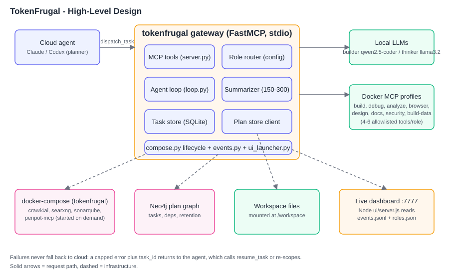
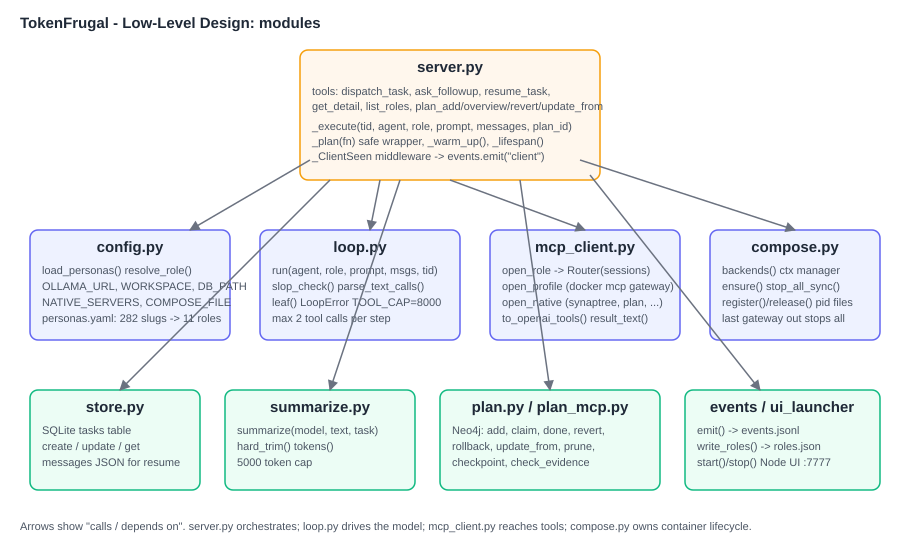
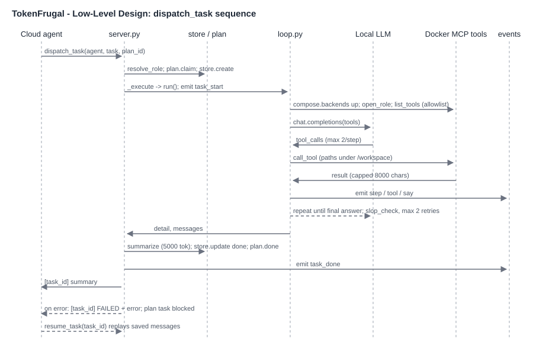

# TokenFrugal architecture

## High-level design



A cloud agent (Claude, Codex) plans and calls the router's MCP tools. The router routes each task by persona to a role (builder or thinker), runs a bounded tool-calling loop against a local LLM, reaches tools through Docker MCP profiles, and returns a summary of up to 5000 tokens. Full output stays in the SQLite task store and is fetched on demand with `get_detail`. Failures never fall back to the cloud: the agent gets a capped error and a `task_id` to pass to `resume_task`.

## Low-level design

### Modules



| Module | Responsibility |
| :--- | :--- |
| `router/server.py` | FastMCP tools, lifespan (UI, compose, Neo4j warm-up), `_execute` pipeline |
| `router/config.py` | Env config, `agents.yaml` loading, `resolve_role` |
| `router/loop.py` | Bounded agent loop, slop checks, text tool-call recovery |
| `router/mcp_client.py` | Docker profile and native MCP sessions behind one `Router` |
| `router/compose.py` | On-demand backend containers, last-router-out shutdown |
| `router/store.py` | SQLite task persistence for follow-ups and resume |
| `router/summarize.py` | Summary capped at 5000 tokens |
| `router/plan.py`, `plan_mcp.py` | Neo4j plan graph and its MCP surface |
| `router/events.py`, `ui_launcher.py`, `ui/` | Event log and the live dashboard on port 7777 |

### GPU lease

`router/gpu_lease.py` (stdlib only) keeps one exclusive record of who holds the GPU: a ComfyUI session or a kalamanch script. The record is `gpu.json` in the leases folder, written through a temp file and `os.replace`, and changed only under the `gpu.lock` file. `acquire` writes a `pending` lease, unloads Ollama models (`keep_alive` 0, then polls `/api/ps`), checks free VRAM with nvidia-smi against a 6 GB minimum, and only then writes `held`; any failure deletes the pending lease. The holder heartbeats every 5 s. A lease whose heartbeat is more than 30 s old is expired, and it is taken over only when its holder is dead (kalamanch pid gone, or ComfyUI container stopped) and ComfyUI reports no running job. The router calls `guard_ollama` before each local Ollama request: a held lease, or an expired one still inside its 30 s refusal window, raises `GpuBusy`, which becomes a failed task with a retry hint rather than a silent wait. Remote Ollama URLs are not checked.

```text
kalamanch run.py, ComfyUI bridge                  router, before each local Ollama request
  acquire
    [lock] write gpu.json state=pending             read gpu.json (no lock)
    unload Ollama, poll /api/ps                       |
    nvidia-smi free VRAM >= 6 GB                      +- held, or fresh          -> GpuBusy (retry hint)
    [lock] write state=held                           +- expired, <30 s past TTL -> GpuBusy
  heartbeat every 5 s: [lock] refresh heartbeat_at    +- expired, ComfyUI running -> GpuBusy
  release                                             +- otherwise               -> run the task
    ComfyUI: POST /free, re-check VRAM (keep lease if low)
    [lock] delete gpu.json if generation matches
```

### dispatch_task sequence


